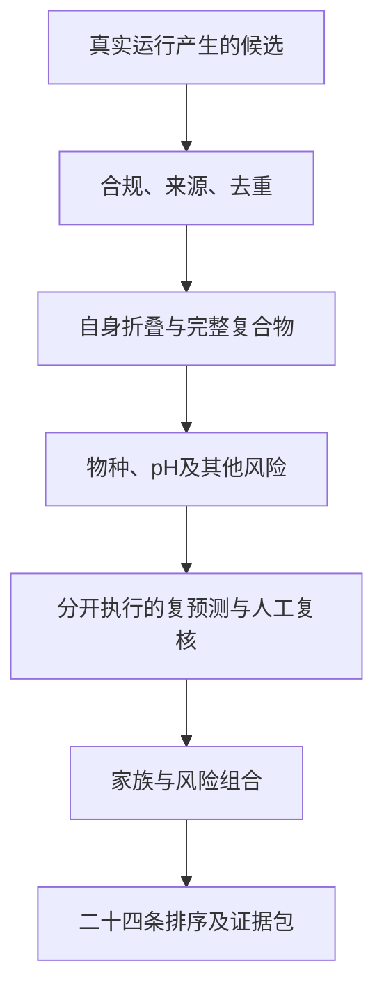

# Poreva Open 2026 参赛指南：评分策略与完整执行流程

_版本 1.0｜资料核查日 2026-11-03｜北京时间 UTC+8｜项目：`/personal/DPcompetition/poreva-open-2026`。_

本指南把已公开规则、研究证据和内部执行建议分开。目标是争取真实实验得分与有效入围，不把预测分数、方法复杂程度或生成数量当作比赛成绩。官方规则可能更新，执行前核对本项目保存的版本及最新答复。

## 🎯 1. 当前决定、已有条件和最先要做的事

### 1.1 当前建议

先对 **TNF-α 开展有限预算小试**，同时完成 EGFR 的输入与接收状态核查。小试出现可信的候选家族后才扩大投入；EGFR 若表现更好，就切换主攻。GLP1R 暂不投入首轮主预算，除非团队获得可靠的功能设计支持。

这个选择还没有变成已经验证的结论。最新公开研究既包含 TNF-α 设计失败，也包含成功结合、跨物种和 pH 响应的例子。合理行动是比较证据与可执行性，不是认定它“容易”或“做不出来”。

总榜按五道题累积分。先建立一个可靠提交，再在 **11 月 8 日**根据第4、5题重做资源决策。单题突破与总榜覆盖是两个层面，不为题目数量牺牲全部候选质量。[官方计分与赛程](https://porevaopen.megalaxylab.com/)

### 1.2 项目实际状态

| 项目 | 截至本轮的实际状态 |
|---|---|
| 项目目录和表格 | 用户已创建；本指南沿用已有目录、ID与表头 |
| 目标资料 | 项目已有三题官方FASTA、人鼠资料及UniProt核对记录；本轮没有独立重做所有序列核验 |
| 格式检查工具 | 已存在 `tools/check_submission.py`，最新版本含 `--rules form`／`--rules guide`；本轮只读核查，未修改或重跑 |
| 报名、四份文件同意、团队授权 | 本轮未执行；不能从已有账号显示推断已完成 |
| 模型安装、GPU任务、设计序列 | 本轮未开展 |
| 规则资料 | 补充官方公开页面快照、评分审计及文献证据卡 |
| `myself` | SSH可访问；当前环境检测约2个逻辑CPU、3.8 GiB内存 |
| GPU | `/usr/bin/nvidia-smi` 执行出现格式错误，尚未验证到可用GPU；不能按已接入A100/L4安排正式作业 |

环境原始记录保存在 `reports/environment_2026-11-03.json`。共享文件系统报告的逻辑容量不等于用户存储配额；可用算力与费用仍需按真实实例核对。当前开发机可承担资料、脚本和索引工作，GPU计算在确认资源后部署。

### 1.3 先完成四个决定

1. 确认至少三名成员、队长单位邮箱与团队授权。
2. 取得仍有接收名额的状态、最终格式、截止时分及评分聚合口径。
3. 选定一次提交的题目、分子类型和表达系统；目前界面一次只选一组。
4. 确认GPU实例、显存、可用时段、费用与存储上限，再设置小试预算。

不依赖答复的文献整理、目标身份核对和软件资料准备可以继续；未决问题不能静默改成已确认。

## 📊 2. 把比赛分数拆成真正的工作目标

### 2.1 已公开的分值

| 指标 | EGFR | TNF-α | GLP1R |
|---|---:|---:|---:|
| pH选择性 | 60 | 60 | — |
| 人鼠交叉反应 | 50 | 50 | — |
| 细胞激动 | — | — | 100 |
| 人源亲和力 | 40 | 40 | 50 |
| 低非特异性结合 | 30 | 30 | 30 |
| 热稳定性 | 20 | 20 | 20 |
| 当前每题合计 | 200 | 200 | 200 |

分值来自[EGFR](https://porevaopen.megalaxylab.com/challenges/egfr)、[TNF-α](https://porevaopen.megalaxylab.com/challenges/tnf-alpha)、[GLP1R](https://porevaopen.megalaxylab.com/challenges/glp1r)正式题页。**满分已包含权重，不要再乘一次百分比。** 后两题未发布，不能自行推定它们的分值和要求。

公开表按各指标前十名给离散名次分。因此，KD改善多少倍不直接等于增加多少分。先把分项资格与功能做完整，再比较投入在哪个短板上更有价值；不能一味追求最强人源结合，把110分对应的条件响应与跨鼠目标留到最后。

### 2.2 目前无法精确计算预期总分

尚未找到完整定义的事项包括：人源亲和门槛、pH比值究竟使用什么量、无可检测结合的下限、不同候选怎样聚合成团队指标、低非特异性占比的分母、表达失败和未入选怎样计分、同分处理，以及GLP1R功能的具体量化公式。

所以暂时不建立“预计冠军概率”或自动总分公式。内部表显示多个指标、证据等级和风险；需要情景分析时把假设写出来。例如，“取最佳分子”和“按合格比例”会导向不同组合，但二者都不能冒充已公布规则。

完整问题与证据见 `docs/rules/2026-11-03_scoring-audit.md`。

### 2.3 得分前还有两个前提

第一是**合规和可测量性**。不合规、无法形成有效实验样本或没有有效读出的设计，再漂亮的预测也不能替代实验。第二是**进入验证的名额**。官方说明合规后按提交时间安排，同时支持材料参与遴选判断；不要理解成先占位就保证入选。[官方遴选说明](https://porevaopen.megalaxylab.com/challenges/tnf-alpha)

实际优先级：先完成合规与来源检查，形成可信候选和可打开的支持材料，再尽早正式提交。不要等到截止日，也不要用不完整包赌提交后可改。

## 🔎 3. 三题的研究证据与选择条件

### 3.1 TNF-α：有机会，也有明确失败证据

题目要求人源与小鼠目标、pH 7.4结合而6.0无可检测结合；目标是可溶性三聚体。需要兼顾跨亚基空间和实际检测构建。[TNF-α题页](https://porevaopen.megalaxylab.com/challenges/tnf-alpha)

| 研究 | 能说明什么 | 不能说明什么 |
|---|---|---|
| AlphaProteo：TNF-α 0/54 | 某些表位和流程很难，不能把经典靶点当简单题 | 所有方法都不可能成功 |
| BoltzGen：该TNF评测中VHH 0/15、protein 0/20结合 | 新工具或成功表达并不保证结合 | 本队或所有构建的固定失败率 |
| 2025人／犬TNF minibinder研究 | 经过大库计算精筛可得到跨物种结合候选 | 少量随机设计的成功率；人／鼠一定交叉 |
| 2025 pH敏感binder研究 | 确有TNF-α pH响应实证 | 在pH6.0必然无结合、满足本赛全部条件 |

原始来源：[AlphaProteo](https://arxiv.org/html/2409.08022v1)、[BoltzGen作者论文](https://hannes-stark.com/assets/boltzgen.pdf)、[人／犬TNF研究](https://www.nature.com/articles/s42003-025-09030-7)、[pH研究](https://pmc.ncbi.nlm.nih.gov/articles/PMC12621740/)。各研究的筛选分母、构建与限制见 `references/literature/` 的证据卡。

新文献修正了仅凭0/54判断的局限。pH论文同时包含TNFR2和TNF-α，不能只看摘要就误写为“仅研究TNFR2”。但该TNF结果涉及已有设计binder的改造，不能把其保留结合比例当成从零生成的成功率。参赛不直接使用发表阳性序列作起点。

### 3.2 EGFR：条件备选，并非已确认关闭

要求酸性pH6.5结合、pH7.4无可检测结合，并兼顾人鼠。需要正确处理胞外构建、结构状态和糖基化背景。与TNF的pH方向相反，不能直接复用同一个响应假设。[EGFR题页](https://porevaopen.megalaxylab.com/challenges/egfr)

截至核查，首页卡片写Closed，详情写Open；官方前端使用的匿名题目接口也返回open。应记录这个冲突，不能据首页直接排除，也不能据接口保证实际提交成功。公开接口证据保存于快照目录，未进行登录提交验证。

EGFR已有酸性增强结合研究，但“不同pH有倍数差”仍不等于中性条件无可检测结合。只有与赛方条件匹配的测量才回答后一个问题，详见pH证据卡。

### 3.3 GLP1R：功能筛选是关键障碍

激动占100分。高质量胞外结合结构无法证明激动；激动还涉及完整受体状态和细胞读出。官方人源构建为24–432片段，并说明检测构建包含未公开的热稳定突变，不能只依赖野生型胞外片段预测。[GLP1R题页](https://porevaopen.megalaxylab.com/challenges/glp1r)

只有团队有具体、可审查的功能设计与评估能力，才重新考虑主攻。不要因为“无需跨鼠与pH”就把本题当作省事选择。

### 3.4 切换条件

- TNF候选只在删除邻链后成立、重预测普遍不保持、几乎只剩同一高风险家族：停止放量，先修输入，必要时转EGFR。
- EGFR确认有名额且相同预算下产生更可信家族与功能证据：更新主攻决定。
- 两题都没有可信结果：保留一个已跑通流程诊断，不无限堆新工具；重新评估首轮投入与第二轮机会。
- 任何切换均记录成本、证据和剩余时间；不得把修复后的结果覆盖原始失败记录。

## 🧬 4. 靶点、分子类型和表达形式要先对齐

### 4.1 每个目标的最小输入包

沿用项目代码 `TNFA`、`EGFR`、`GLP1R`。在 `targets/<挑战>/` 保存：原始序列与结构、来源和日期、实际构建、物种、UniProt区间、结构链、残基映射、装配、准备步骤和未知项。

| 输入问题 | 需要留下的证据 |
|---|---|
| 是否同一个蛋白／异构体 | 官方编号、区间、序列长度和边界残基 |
| 坐标是否覆盖目标 | 缺失、工程突变、插入码与补全区域 |
| 生物学装配是否正确 | 单体／多聚体、链映射和完整装配文件 |
| 计算裁剪是否合理 | 裁剪理由、新增边界、回填完整结构后的检查 |
| 人鼠如何对应 | 逐残基映射、结构上下文及差异区域 |
| 实验形式是否一致 | 标签、融合位置、价态、表达和检测构建 |

不能仅因物种总体序列相似就判定交叉结合；也不能因为参考PDB给出坐标，就假定其表达系统与官方试剂完全一致。

### 4.2 从头来源

公开阳性研究用于理解机制、评价方法或做隔离的工具校准，不直接作为参赛序列或亲和优化起点。团队自己从头产生的候选及后续变化逐代保存父子关系。工具示例、公开抗体和真实候选分开存放，避免导出时混入。

VHH使用通用框架与使用已知阳性binder的边界需依正式规则确认，不能简单认为“换了CDR所以一定合规”。没有证据证明来源合规的候选不进入正式清单。

### 4.3 表达系统影响实验对象

页面允许选择HEK293或无细胞，但实际构建可能由平台添加标签或Fc。自带融合片段、重复提交不同系统、混合分子类别等不能自行假定允许。单链预测结果与多价融合形式的表观结合结果不应直接互换。

对每个候选记录：本体序列、预期融合形式、价态、目标寡聚状态和测定条件。最终系统依据分子特点与官方说明决定，不能只因某种格式可能产生更强表观信号就认定得分更高。

## 🖥️ 5. 软件和算力：建立一个可信基线

### 5.1 工具分工

| 职责 | 建议 | 采用条件 |
|---|---|---|
| 主生成 | 一个已验证可运行的BindCraft系列版本 | 输入、日志、序列、结构可导出；版本与许可明确 |
| 新版本评估 | BindCraft2有界环境测试 | 多目标等功能确有需要，且不会耗尽首轮时间 |
| 第二生成支路 | BoltzGen | 小预算验证能增加家族或结构多样性 |
| 复预测 | 与生成过程分开的预测配置；条件允许使用另一模型 | 检查实际输出、PAE兼容性、许可与数据使用方式 |
| 界面置信度 | ipSAE等指标 | 固定模型、参数、链映射和汇总方式 |
| pH物理复核 | 只用于少数已有可信基础结合的候选 | 有明确方法、假设、采样与收敛记录 |

BindCraft2目前有公开仓库，不应再写成未发布；但其新功能列表不能直接当作该模式具有稳定实验命中率的证据。主线若已稳定，不为追新而全量升级。[BindCraft2](https://github.com/PacesaLab/BindCraft2)、[BindCraft](https://github.com/martinpacesa/BindCraft)、[BoltzGen](https://github.com/HannesStark/boltzgen)

### 5.2 环境验收

先验证GPU可见性、驱动、显存、CPU／内存、真实存储配额和模型许可，再用非参赛示例做端到端测试。记录源码commit、权重标识、依赖、完整命令、运行时间、退出码和输出哈希。成功后冻结环境；升级用新环境，不覆盖当前生产版本。

实际模型安装和任务命令应在确定版本后生成到 `configs/` 与运行清单。本指南不提供未经该环境验证的安装命令，也不把目录里的待办当成已经可运行的流水线。

### 5.3 A100与L4分工

主目标为完整TNF三聚体时，总残基数包括所有目标链和binder，不是157加binder。显存还受模型版本、padding、采样和并发影响。A100优先做完整复合物与重任务；L4只安排实测能装入显存的任务。为省显存裁剪目标时，最终必须回到完整装配核查。

BindCraft2官方安装文档有不同显存下的总长度参考，但它是特定设置下的测量，不是硬件承诺。见模型证据卡；不要仅依据GPU名字估计每天可产多少高质量候选。

### 5.4 小试与总预算

预算按GPU型号分别记录，不把L4小时当成A100小时。给首次小试1–2个工作日的工程窗口，明确GPU小时和费用上限。若同时做TNF／EGFR比较，尽量保持工具版本、GPU类型及评估口径一致，并把目标准备时间和失败成本计入。

初始预算可讨论按15%环境与小试、40%生成、35%复核、10%缓冲分配；这只是内部起点。根据小试测得的有效家族成本调整，保护长江杯的关键工时，避免两份排期重复占用同一GPU。

## 🔬 6. 各项得分对应的设计与复核工作

### 6.1 人源结合：先有可信的基础能力

先检查真实目标构建下的结合结构和binder自身折叠，再考虑其他功能。生成过程给出的漂亮结构必须用实际序列重新评估，并复核完整装配、链编号、碰撞和非天然边界。

把模型置信度、界面物理合理性、独立重预测一致性分列，不用任意加权和掩盖明显失败项。不同模型可能共享训练数据或先验，模型一致性提高可信度，但不是独立实验证明。

### 6.2 pH选择性：机制证据必须贴近题目条件

| 层级 | 能支持的判断 | 不能声称 |
|---|---|---|
| 结构预测 | 折叠和界面在该模型下可行 | 已证明pH响应 |
| 质子化／局部环境分析 | 有可检验的响应机制假设 | 已知准确转换点、KD或选择性倍数 |
| 物理模拟 | 在指定模型与采样下的条件差异 | 短轨迹未解离等于真实稳定结合 |
| 条件匹配的实验 | 支持该检测窗口内的结合或未检出 | 绝对不结合、所有环境均成立 |

2025年的TNF pH研究主要比较5.4与7.4；本赛要求6.0与7.4。酸性响应可能存在阈值差异，不能通过插值或改配置标签宣称达标。EGFR方向又相反，不能直接照搬酸性释放策略。[原始pH研究](https://pmc.ncbi.nlm.nih.gov/articles/PMC12621740/)

pKa计算用于提出假设；固定质子化MD只比较预设状态；恒pH模拟还要面对采样和收敛限制。新pH感知模型需审查其训练、实证目标及测量条件，先列研究支路，不让新颖性取代验证。

pH响应与热稳可能存在取舍：依赖蛋白整体不稳定造成的释放，需要特别审查在赛方其他检测条件下是否损害可表达性和稳定性。只增加某种氨基酸的数量没有充分依据，不能用残基计数作为响应评分。

本指南不直接实施序列改造。方法原则仅可在团队自有、来源合规的从头设计上进一步研究；发表的阳性起点不能混入参赛。

### 6.3 人鼠交叉：把短板显式显示

对同一候选分别使用官方人源和鼠源构建评估，核查序列差异是否落在关键接触、构象或遮挡相关区域。比较同一候选在两个物种上的结果，不把两个不同候选各自结合不同物种算成一个交叉设计。

内部可用“先改善较弱物种”的筛选思路，但不同目标的原始分数分布未必可直接比较。保存各自结果和条件，避免平均分掩盖某一物种明显失败。人／犬论文仅提供跨物种设计可行性背景，不能替代本赛人／鼠证据。

### 6.4 低非特异性：减少明显风险，保留未知

复核暴露疏水斑块、极端表面电荷、潜在聚集、结构不稳定或异常残基环境，并记录指标的适用范围。这些是计算风险信号，不是低非特异实验的证明。

少数负目标预测低分也不能代表全蛋白组特异性。官方检测面板和分母未公布前，将具体非特异得分标为未知。避免把提高pH响应的一种局部改动同时引入的新风险藏在综合分数里。

### 6.5 热稳定性：不要用pLDDT代替Tm

复折叠一致、序列与骨架相容、物理能量和聚集风险可以辅助筛选，但不直接给出热稳定性终点。高结构置信度与热稳不是同一个量，具体数据集上的预测关联也不能无条件迁移。

先问清官方测的是Tm、热处理后残余结合还是其他量；没有定义时不写“预计热稳得20分”。本体、融合形式和检测pH都要随结果保存。

### 6.6 GLP1R若后续启用

建立功能假设与受体状态检查，明确需要哪些证据支持激动。结构结合、阻断和激动是不同结果；没有功能依据的候选不能仅靠高界面分数排到最前。实验终点和聚合定义待官方明确后再决定是否值得从其他题转入预算。

## 🧩 7. 从大量候选到24条提交组合

### 7.1 分层漏斗

每层在 `reports/funnel.tsv` 记录输入、通过、淘汰、未检查和失败原因。程序错误与科学失败分开，不把程序没有产出当成低分。

### 7.2 指标记录

沿用 `registry/candidates.tsv`、`evaluations.tsv`、`metrics.tsv`、`provenance.jsonl`。为每次评估绑定候选、实际序列哈希、目标版本、工具版本、配置、种子和原始文件。

ipSAE依赖PAE、坐标顺序、链划分和阈值；不同工具或列名不能直接混排。TNF三聚体逐链查看目标与binder界面，不能把目标亚基之间的高分误当成binder成功。保存全部方向及汇总约定。[ipSAE作者实现](https://github.com/DunbrackLab/IPSAE)

不存在官方规定的本地“ipSAE过线值”。可使用锁定工具的默认过滤作为起点，在实际数据和公开校准资料上复核；改变阈值需记录理由，不为凑够24条临时放宽。

### 7.3 组合原则

- 先通过统一质量门槛，再考虑多样性；高新颖性不能抵消明显结构错误。
- 在序列、骨架、界面和共同失败假设四个层面检查相关性。
- 不让一条生成轨迹的大量微变体占满名额；模型名称不同也不自动等于设计独立。
- 可以少量保留有明确机制理由的亲本／变体对，但要考虑评分聚合、名额和两条能否同时入选；不强制规定配对数量。
- 每条必须有具体入选理由、主要风险、来源与评估记录；高分被排除也应说明原因。
- 团队聚合方式未明时，保留不同合理组合的内部对比，不把某个固定比例称为最优解。

24条是文件要求，不是24次独立成功试验。没有合规的完整组合时，不用重复设计或无依据序列凑数；先调整工作计划、咨询规则或重新评估投入。

### 7.4 排序

排名1放最希望被优先验证的设计，理由应同时考虑基础结合、功能相关证据、表达与构建风险、家族信息和未知项。按实际验证意愿排序，不简单按生成器输出分数降序。

拟定清单由另一成员复核。看最终实际序列对应的结构，而不是上一版截图。结构内序列、CSV字符串与候选哈希必须一致。

## 📅 8. 从现在到截止的推进安排

| 时间 | 工作 | 交付与决策 |
|---|---|---|
| 11-03至11-04 | 规则、成员、名额、目标和GPU核查 | 更新答复记录、目标卡、实际预算 |
| 11-04至11-06 | 一个主生成器与复预测器的小试 | 成功环境、候选来源、失败分布、家族与成本 |
| 小试结束当天 | TNF／EGFR主攻判断 | 依据证据更新决策，不只比较最高分 |
| 11-07至11-10 | 受控扩量与逐批复核 | 初步候选池、功能证据和风险清单 |
| 11-08 | 阅读第4、5题 | 评估总榜价值；不以自动日历任务形式执行，本轮未建提醒 |
| 11-10至11-14 | 选择组合、补证据、撰写材料 | 可冻结的24条、支持材料与排序理由 |
| 11-12至11-15 | 条件成熟即正式提交 | 真实成功状态、规则版本、文件哈希与回执 |
| 11-16至11-18 | 缓冲与状态核对 | 解决错误与未明状态，不将最后一天作为首选提交日 |
| 11-19至11-25 | 官方确认流程 | 按当时要求核对已冻结序列 |
| 11-26 | 首轮遴选结果 | 实际入选清单与来源映射 |
| 12-08前 | 已决定参加的第二轮 | 独立准备、冻结与提交 |

官方题页已说明北京时间，但截止具体时分仍需确认。上述工作日程是内部建议，账号、GPU和实际候选产出可能改变它。已经审查合格且确认名额时可更早提交。[官方赛程](https://porevaopen.megalaxylab.com/)

原项目的11月17日目标保留为历史排期，不作为等待理由。若到11月10日仍没有可靠候选家族，停止扩量，集中诊断并重新评估首轮与第二轮的分配。

角色分工：队长负责规则、授权和提交；结构负责人负责目标、装配与功能假设；计算负责人负责环境、运行和索引。三人可以交叉，但最终提交前应有不同人员做第二次核查。

## 📤 9. 支持材料、正式提交与实验回收

### 9.1 提交材料的作用

支持材料帮助遴选者判断设计与来源，不能替代实测评分。提供真实模型版本、输入与处理、生成与筛选、结构、原始指标、局限和最终排序理由。外链应可打开、只读、固定版本，并有文件索引。

建议每条候选证据页包括：ID与哈希、类型与表达选项、来源运行、目标版本、结构路径、指标表、pH／跨鼠依据、主要未知与入选理由。不要为了“资料充分”堆积无法复现的截图，也不要在材料里放操控评审模型的指令。

### 9.2 本地格式检查不是官方合规结论

既有 `tools/check_submission.py` 已增加两套口径：`--rules form` 按表单的300 aa上限和VH:VL等语法；`--rules guide` 按使用说明的40–250范围和对应分子形式。两套程序检查帮助发现冲突，却不能替官方决定采用哪套；例如FAQ单链要求>40，仍与包含40的范围有差异。工具也不能判断从头来源、真实框架或功能，通过后还必须完成正式规则审查。

Protein小试可先避开边界，选择符合已见较严格范围的设计；这只是减少返工，不是替官方决定最终长度。实际CSV表头仍要以真实下载模板核对。不得仅因前端接受或脚本返回成功就正式提交存在规则疑问的序列。

### 9.3 冻结与提交

团队保有设计所有权，不等于序列和结果始终保密。官方条款规定主办方的相关使用许可及部分数据的开放安排；团队应阅读实际接受的中文版本，确认成员、单位及其他权利人的授权，尤其核查公开与潜在专利的关系。原始网页中类似`$12`的序列化引用不能当作条款正文或条款缺失的证明，应回到完整可见文件核对。[正式文件入口](https://porevaopen.megalaxylab.com/register)

使用 `submissions/<挑战>/<版本>/` 保存序列、摘要、候选映射、支持材料索引、manifest、哈希和回执。正式操作顺序：

1. 确认最新规则、实际名额与团队授权，记录适用版本。
2. 冻结科学清单与文件，使用解析器重读并检查哈希。
3. 队长确认账号、题目、类型、表达系统与模型名称。
4. 上传后核对网站显示的条数、名称、序列及补充信息。
5. 完成正式确认，保存时间与成功状态；草稿不算完成。
6. 官网结果不明时标记 `uncertain`，先核实，不盲目重复上传。

正式说明写提交锁定，表单提供修改联系渠道。按不可自行修改准备，纠错由组委会确认。规则宣示提前冻结，同时条款保留更新权；记录正式答复和版本，不能把页面示例文案当冻结凭证。

### 9.4 实验结果与复盘

原始结果保存在 `official_results/raw/`，不覆盖。区分未入选、合成／表达失败、检测无效、未检出和有效测量；未检出不填成KD为0或人为大数。保留原单位、检测范围与构建，再做换算和分析。

入选样本经过先验筛选，不能据此估计整个生成库的无偏命中率。结果解释同时看家族、评分相关证据和实际测试条件，分析哪些计算指标有帮助、哪些只制造漂亮分数。

## 📚 10. 文件入口、证据管理与首日检查表

### 10.1 本轮新增资料

| 文件 | 用途 |
|---|---|
| `docs/参赛指南_评分策略与全流程.md` | 本指南 |
| `docs/rules/2026-11-03_scoring-audit.md` | 官方评分、未知定义与规则冲突 |
| `references/literature/2026-11-03_ph-evidence.md` | pH原始研究、条件差异与证据分层 |
| `references/literature/2026-11-03_models-and-target-evidence.md` | 模型、TNF正反证据和硬件限制 |
| `docs/rules/snapshots/2026-11-03/` | 本轮公开网页与题目接口快照、时间和哈希 |
| `reports/environment_2026-11-03.json` | 当前开发机环境探测结果 |

快照是公开HTTP响应，包含网页代码；它不等于已经完成报名，也不等于四份文件已被团队接受。只把实际可见内容、正式文档和可验证接口当证据，不把隐藏示例文本当真实提交记录。

### 10.2 证据标记

使用 `official_confirmed`、`public_paper`、`internal_hypothesis`、`unconfirmed` 区分来源；实验结果另外记录具体条件。公开论文有成功例子不意味着可以复用阳性序列，也不意味着我们的候选已被验证。

已有README、排期、格式说明和决策记录会补充本轮更新入口；旧内容保留历史，不覆盖他人已有运行或候选数据。现有字段继续使用，新增指标先在 `registry/schema.md` 说明再写表。

### 10.3 立即执行清单

- [ ] 落实三人、单位邮箱和成员授权。
- [ ] 确认实际接收状态与剩余验证容量。
- [ ] 确认长度、scFv格式、提交批次、截止时分与修改流程。
- [ ] 向官方询问阈值、pH比值、团队聚合及失败计分；本轮没有发邮件。
- [ ] 取得GPU实例，验证驱动、显存和任务预算。
- [ ] 核对人／鼠目标输入与完整装配。
- [ ] 一个主流程加一个复预测流程完成端到端小试。
- [ ] 依据家族、功能证据和成本作选择，保护长江杯工作时间。
- [ ] 按真实进展冻结和尽早提交，保存回执。

指南是执行依据与研究记录，不是候选分子的实验认证。后续每个“已完成、已通过、已提交”都需要对应真实文件、运行记录或官网状态。
